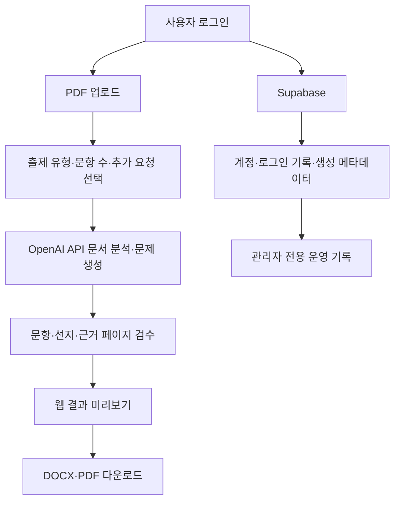

# 6. 시험제작소

PDF 강의자료를 올리면 대학 시험용 예상문제집, 모범답안·해설, 출제 분석을 자동으로 제작하는 Streamlit 웹앱입니다.

> **배포 상태:** 정상 운영 중<br>
> **실행 방식:** 웹 링크 접속<br>
> **데이터베이스:** Supabase 영구 저장소<br>
> **소스 배포:** GitHub `main` 브랜치 자동 반영

## 바로가기

| 구분 | 링크 |
|---|---|
| 시험제작소 앱 | [https://exam-maker-korea.streamlit.app](https://exam-maker-korea.streamlit.app) |
| GitHub 저장소 | [https://github.com/minzaist/exam-maker-korea](https://github.com/minzaist/exam-maker-korea) |
| macOS 바탕화면 바로가기 | `~/Desktop/시험제작소.app` |

## 한눈에 보는 구조



## 주요 기능

### 문제집 제작

- 여러 PDF를 한 번에 업로드
- 객관식, 단답형, 서술형, 논술형, OX형, 빈칸 채우기, 사례 분석형 선택
- 출제 유형 복수 선택
- 총 문항 수와 과목명 지정
- “3장은 비중을 높여줘” 같은 추가 요청 반영
- 주제 배분과 상·중·하 난이도 자동 구성
- 모든 문항에 원본 PDF 근거 페이지 표시

### 객관식 자동 검수

- 5지선다 선지 구성
- 정답만 지나치게 길어지지 않도록 검사
- 선지별 길이와 핵심 키워드 균형 검사
- 자료에 없는 내용이 선지에 포함됐는지 검증
- 오답이 정답과 과도하게 떨어지지 않도록 균형 조정

### 결과물

- 예상문제집 PDF
- 모범답안 및 해설 PDF
- 출제 분석 요약
- 한컴오피스 한글과 Word에서 열 수 있는 DOCX 2종 ZIP
- 복사해서 바로 사용할 수 있는 전체 텍스트
- PDF 글자 깨짐·페이지 잘림 자동 교차검증

## 사용 방법

1. 앱 링크에 접속합니다.
2. 군번과 이름으로 가입하거나 로그인합니다.
3. 시험 범위 PDF를 업로드합니다.
4. 출제 유형, 문항 수, 과목명, 추가 요청을 입력합니다.
5. **예상문제집 만들기**를 누릅니다.
6. 문제·해설·출제 분석을 확인한 뒤 DOCX나 PDF를 내려받습니다.

공용 PC를 사용할 때는 **이 브라우저에서 로그인 유지** 선택을 끄고, 사용 후 반드시 로그아웃합니다.

## 관리자 기능

관리자 계정으로 로그인하면 홈 화면에 **운영 기록** 탭이 추가됩니다. 일반 계정에는 탭 자체가 노출되지 않습니다.

### 문제 생성 기록

- 사용 계정, 요청 시간, 파일명, 출제 유형, 문항 수 조회
- 추가 요청과 성공·실패 상태 확인
- JSON 내려받기

### 로그인 기록

- 로그인 시간, 방식, 브라우저 정보 조회
- JSON 내려받기
- 삭제할 기록 복수 선택
- 영구 삭제 확인 후 선택 기록 삭제
- 삭제 시 서버가 관리자 권한을 다시 검증

> 로그인 기록 삭제는 복구할 수 없습니다.

## 계정과 데이터 저장

- 계정, 로그인 기록, 생성 요청 메타데이터는 Supabase에 저장됩니다.
- 앱을 종료하거나 Streamlit 서버가 재시작돼도 계정과 기록은 유지됩니다.
- 군번 원문은 저장하지 않고 HMAC 지문과 마스킹 값만 저장합니다.
- 로그인 유지 토큰은 브라우저에 저장하고, DB에는 SHA-256 해시만 저장합니다.
- 업로드한 PDF 원문과 생성된 문제·답안 전문은 운영 기록에 저장하지 않습니다.

## 프로젝트 구성

| 경로 | 역할 |
|---|---|
| `app.py` | Streamlit UI, 로그인, 관리자 화면, 생성 흐름 |
| `ui.py` | 전체 디자인과 반응형 CSS |
| `generator.py` | OpenAI API 호출과 생성 결과 구조 검증 |
| `prompts.py` | 대학 시험 출제 프롬프트 |
| `exports.py` | 문제집·해설 DOCX/PDF 제작과 PDF 교차검증 |
| `storage.py` | SQLite/Supabase 저장소, 계정, 세션, 기록, 권한 |
| `supabase_schema.sql` | 초기 Supabase 테이블·인덱스·권한 구성 |
| `supabase/migrations/` | 추가 DB 마이그레이션 |
| `assets/` | PDF에 삽입하는 한글 글꼴 |
| `tests/test_core.py` | 출력물, 계정, 관리자 권한 자동 테스트 |
| `requirements.txt` | Python 패키지 목록 |

## 로컬 실행

```bash
cd "6. 시험제작소"
python3 -m venv .venv
source .venv/bin/activate
pip install -r requirements.txt
mkdir -p .streamlit
cp .streamlit/secrets.example.toml .streamlit/secrets.toml
streamlit run app.py
```

`.streamlit/secrets.toml`에 실제 API 키와 서버 설정을 넣습니다. 실제 비밀키는 GitHub에 올리지 않습니다.

```toml
OPENAI_API_KEY = "sk-..."
OPENAI_MODEL = "gpt-4.1"
AUTH_PEPPER = "충분히 긴 임의 문자열"
ADMIN_SERVICE_NUMBER = "관리자 군번"
ADMIN_NAME = "관리자 이름"
DAILY_GENERATION_LIMIT = 3
SUPABASE_URL = "https://your-project.supabase.co"
SUPABASE_SECRET_KEY = "sb_secret_..."
```

## 배포 구조

1. 로컬 `main` 브랜치의 수정 내용을 GitHub에 push합니다.
2. Streamlit Community Cloud가 GitHub `main` 브랜치의 변경을 감지합니다.
3. 새 코드가 자동 배포됩니다.
4. 배포 서버의 Secrets는 GitHub 소스와 분리되어 있습니다.
5. 계정과 기록은 외부 Supabase DB에 있어 배포 갱신 후에도 유지됩니다.

Supabase를 새로 구성할 때는 Dashboard의 SQL Editor에서 `supabase_schema.sql`을 한 번 실행합니다. `SUPABASE_URL`과 `SUPABASE_SECRET_KEY`가 없으면 로컬 개발용 SQLite로 자동 전환됩니다.

## 테스트

```bash
.venv/bin/python -m pytest -q
python3 -m py_compile app.py storage.py generator.py exports.py prompts.py ui.py
git diff --check
```

현재 자동 테스트 범위:

- 문항 번호·구조 정규화
- 문제집·해설 PDF 생성과 렌더링 검증
- DOCX ZIP 생성
- 가입·로그인·세션 복원·로그아웃
- 생성 기록과 일일 한도
- 일반 계정의 로그인 기록 삭제 차단
- 관리자의 선택 로그인 기록 삭제

## 운영 시 주의사항

- OpenAI·Supabase 비밀키를 코드, 문서, 카카오톡에 공유하지 않습니다.
- GitHub에는 `.streamlit/secrets.toml`, 로컬 DB, 가상환경을 올리지 않습니다.
- `Manage app`은 Streamlit 소유자 계정에만 보이며, 일반 공유 사용자에게는 표시되지 않습니다.
- 로그인 기록을 삭제하기 전에 필요하면 JSON 백업을 먼저 내려받습니다.
- 일반 계정은 기본적으로 하루 3회까지 문제집을 생성할 수 있고 관리자는 한도에서 제외됩니다.

## 현재 완료 상태

- [x] 부드러운 앱 스타일 UI
- [x] Y자형 PDF·출제 설정·결과 레이아웃
- [x] PDF 기반 문제집·해설 생성
- [x] DOCX·PDF 다운로드
- [x] PDF 한글 글꼴·렌더링 검증
- [x] 군번·이름 가입과 로그인
- [x] 30일 로그인 유지
- [x] Supabase 영구 DB
- [x] 관리자 전용 생성·로그인 기록
- [x] 관리자 전용 로그인 기록 삭제
- [x] GitHub 자동 배포
- [x] 다른 컴퓨터 접속
- [x] macOS 바탕화면 바로가기

---

이 문서가 시험제작소의 기준 안내서입니다. 운영 링크, 기능, 권한, 배포, 보안, 테스트 방법을 이 파일에서 통합 관리합니다.
